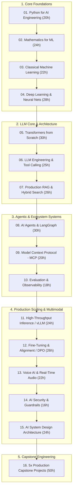

# Applied AI Engineering: Production Roadmap & Curriculum

[]()
[]()
[]()
[](index.html)

A battle-tested, zero-fluff engineering roadmap designed to bridge the gap between traditional software architecture and cutting-edge Applied AI Systems. 

Covers foundational mathematics, deep learning internals, transformer architectures from scratch, production RAG, multi-agent workflows with LangGraph, Model Context Protocol (MCP), high-throughput vLLM inference, fine-tuning with QLoRA/DPO, real-time voice AI, AI security guardrails, and enterprise system design.

---

## Curriculum Roadmap



---

## Curriculum Modules Directory

| # | Module | Core Focus | Target Duration | Directory Link |
|---|---|---|---|---|
| 01 | **Python for AI Engineering** | Asyncio, NumPy Vectorization, PyTorch Tensors, Pydantic v2 | 20 Hours | [01-python-ai/](01-python-ai/README.md) |
| 02 | **Mathematics for ML** | Linear Algebra, SVD, Multivariable Calculus, Backprop Calculus | 24 Hours | [02-mathematics/](02-mathematics/README.md) |
| 03 | **Classical Machine Learning** | Regression, Trees, Random Forests, XGBoost, Scikit-Learn | 22 Hours | [03-machine-learning/](03-machine-learning/README.md) |
| 04 | **Deep Learning & Neural Nets** | Micrograd, Makemore, Batch Normalization, AdamW Optimizer | 28 Hours | [04-deep-learning/](04-deep-learning/README.md) |
| 05 | **Transformers from Scratch** | Multi-Head Attention, RoPE, FlashAttention, GPT from Scratch | 30 Hours | [05-transformers/](05-transformers/README.md) |
| 06 | **LLM Engineering** | Reproducing GPT-2 (124M), Structured Outputs, Tokenizer Internals | 25 Hours | [06-llm-engineering/](06-llm-engineering/README.md) |
| 07 | **Retrieval Augmented Generation** | Hybrid Search (BM25 + Dense), PGVector, Cohere Neural Rerank | 26 Hours | [07-rag/](07-rag/README.md) |
| 08 | **AI Agents & Workflows** | LangGraph, ReAct Loops, Stateful Swarms, Human-in-the-Loop | 30 Hours | [08-ai-agents/](08-ai-agents/README.md) |
| 09 | **Model Context Protocol (MCP)** | Client-Server Architecture, stdio/SSE, Tools, Resources, Prompts | 20 Hours | [09-mcp/](09-mcp/README.md) |
| 10 | **Evaluation & Observability** | RAG Triad, RAGAS, Promptfoo CI/CD Testing, LangSmith Tracing | 18 Hours | [10-evaluation/](10-evaluation/README.md) |
| 11 | **High-Throughput Inference** | vLLM, PagedAttention, Continuous Batching, GGUF/AWQ Quantization | 24 Hours | [11-inference/](11-inference/README.md) |
| 12 | **Fine-Tuning & Alignment** | LoRA/QLoRA from Scratch, Unsloth, Hugging Face TRL, DPO Alignment | 26 Hours | [12-fine-tuning/](12-fine-tuning/README.md) |
| 13 | **Voice AI & Real-Time Audio** | Faster-Whisper, Silero VAD, Kokoro/XTTS, WebRTC LiveKit Agents | 22 Hours | [13-voice-ai/](13-voice-ai/README.md) |
| 14 | **AI Security & Guardrails** | OWASP Top 10 for LLMs, Injection Defense, NeMo Guardrails | 16 Hours | [14-ai-security/](14-ai-security/README.md) |
| 15 | **AI System Design** | High-Scale Enterprise Gateway, Semantic Caching, Fault Tolerant SlAs | 24 Hours | [15-system-design/](15-system-design/README.md) |
| 16 | **Capstone Projects** | 5x End-to-End Production Systems for Portfolio & Resume | 50 Hours | [projects/](projects/README.md) |

---

## Interactive Progress Tracker & Web Application

This repository comes with a zero-dependency, ultra-responsive interactive web application featuring:
- **Interactive Checklists:** Check off lectures, checkpoints, and projects in real time.
- **Persistent State:** Saves progress automatically to browser `localStorage`.
- **Live Progress Analytics:** Dynamic progress counter, completion percentage, completed hours, and module status badges.
- **In-App Video Modal:** Watch curated YouTube lectures directly inside the app without leaving your study workspace.
- **Search & Filtering:** Instant live filter by keyword, topic, instructor, or status.
- **Progress Export/Import:** Backup and restore your progress across devices as JSON.

To launch the web tracker locally:
```bash
# Simply open index.html in any modern browser, or run:
npx serve .
# or
python3 -m http.server 8080
```

---

## Author & Architect

**Abel Ashine Dadi**
- Senior Systems Architect & Lead Software Engineer
- Co-Founder @ spin.tf & Weleba Technology
- Portfolio: [https://abelashine.weleba.tech](https://abelashine.weleba.tech)
- GitHub: [@AbelAshine1234](https://github.com/AbelAshine1234)
- Email: `abelashinework@gmail.com`
